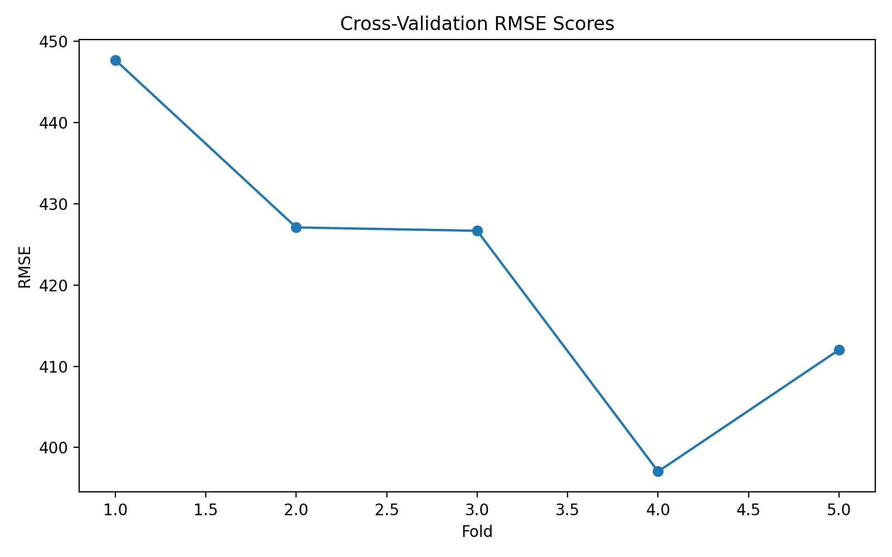
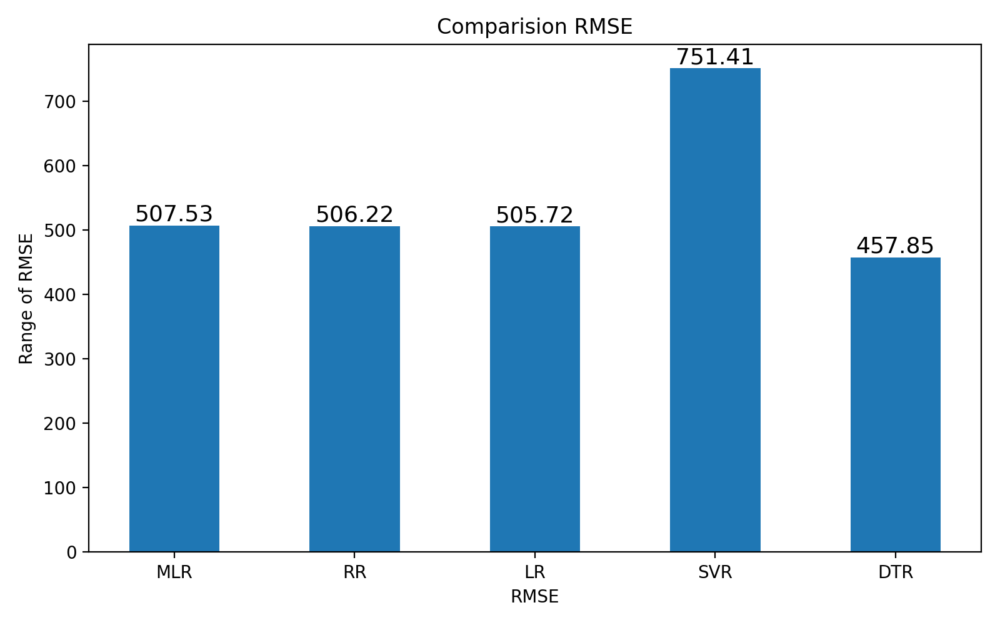

# ☀️ solar_power_forecasting_reproduction

**머신러닝 기반 태양광 발전량 예측 논문 재현 및 회귀·앙상블 모델 성능 비교 프로젝트**

본 프로젝트는 IEEE Access에 게재된 *Solar Energy Forecasting Using Machine Learning Techniques for Enhanced Grid Stability* 논문의 실험 구성을 참고하여, **기상·태양 위치 특징을 이용한 발전량 예측 모델을 Python으로 재구현**한 연구 재현 프로젝트입니다. 총 **9개 회귀 모델**의 성능을 평가하고, **Gradient Boosting Regressor(GBR)**의 5-Fold 교차검증·하이퍼파라미터 탐색과 모델 간 통계적 비교 및 다양한 시각화 결과를 정리했습니다.

> 📌 **재현 범위 안내:** 논문의 모델과 평가 흐름을 참고해 재구현한 **논문 기반 재현 실험**입니다. 원 논문의 데이터 분할·전처리 등 모든 세부 조건이 확인된 완전 동일 환경의 수치적 재현을 의미하지는 않습니다. 제공된 실험 결과와 논문에 보고된 값은 구분해서 해석해야 합니다.

---

## 📌 프로젝트 개요

| 항목 | 내용 |
|---|---|
| 프로젝트 유형 | 태양광 발전량 예측 **논문 재현(Reproduction)** |
| 분석 데이터 | Solar Energy Power Generation Dataset (Kaggle, Meshva) |
| 입력 데이터 | 기상·일사·태양 위치 관련 **20개 특징** |
| 예측 대상 | `generated_power_kw` (태양광 발전량, kW) |
| 비교 모델 | 선형계열·트리·SVR·앙상블 포함 **9개 회귀 모델** |
| 성능 평가 | R², MSE, RMSE, MAE |
| 모델 최적화 | GBR GridSearchCV, **5-Fold 교차검증** |
| 추가 분석 | Permutation Importance, 모델별 매개변수 변화, paired t-test |
| 핵심 실행 파일 | `solar_power_forecasting_reproduction.ipynb` |
| 저장된 결과 | `paper_reproduction_outputs_revised/`의 **총 50개 파일(34 PNG, 16 CSV)** |

## 📁 프로젝트 폴더 구조

```text
solar_power_forecasting_reproduction/
├── README.md
├── solar_power_forecasting_reproduction.ipynb   # 논문 재현 실험 Notebook
├── spg.csv                                      # 실행을 위해 별도 다운로드·배치
└── paper_reproduction_outputs_revised/          # 기존 실험 결과 50개
    ├── 01_cross_validation_rmse_scores_best_tuned_gbr.csv
    ├── 01_cross_validation_rmse_scores_best_tuned_gbr.png
    ├── 02_best_gbr_summary.csv
    ├── 02_gbr_gridsearch_full_results.csv
    ├── 03_top10_permutation_feature_importances.csv
    ├── 04_rmse_comparison_across_5_folds_gbr_rf_svr.csv
    ├── 11_14_ml_algorithm_metric_summary.csv
    ├── 19_22_ensemble_metric_summary.csv
    ├── 23_comparison_of_performance_metrics.csv
    └── ... (나머지 CSV 및 PNG 결과 파일)
```

`spg.csv`는 노트북이 직접 읽는 **원본 입력 파일**입니다. 현재 전달된 파일에는 포함되어 있지 않으므로 별도로 준비해야 합니다. `paper_reproduction_outputs_revised/` 폴더는 노트북 실행에 따라 새로 생성되거나 기존 파일이 덮어써질 수 있으며, 함께 제공된 압축파일을 풀면 확인할 수 있습니다.

| 파일·폴더 | 역할 |
|---|---|
| `solar_power_forecasting_reproduction.ipynb` | 데이터 준비, 9개 모델 학습·평가, GBR 최적화, 비교 그래프 생성 |
| `spg.csv` | 발전량과 기상·태양 위치 특징을 포함하는 원본 입력 데이터 |
| `paper_reproduction_outputs_revised/` | 표 형태의 분석 결과(CSV)와 시각화 이미지(PNG), 총 50개 |
| `README.md` | 참고 논문, 데이터 준비, 실행 방법, 결과 해석 및 재현 한계 안내 |

---

## 📄 참고 논문

| 항목 | 정보 |
|---|---|
| 제목 | **Solar Energy Forecasting Using Machine Learning Techniques for Enhanced Grid Stability** |
| 저자 | Attuluri R. Vijay Babu, N. Bharath Kumar, Rajanand Patnaik Narasipuram, Soundhar Periyannan, Alireza Hosseinpour, Aymen Flah |
| 게재지 | **IEEE Access**, Vol. 13 (2025), pp. 93735–93754 |
| DOI | [10.1109/ACCESS.2025.3574093](https://doi.org/10.1109/ACCESS.2025.3574093) |
| 논문 페이지 | [IEEE Xplore](https://ieeexplore.ieee.org/document/11015947) |

논문은 다양한 머신러닝 및 앙상블 회귀 모델을 태양광 발전량 예측에 적용하고, 기상 조건과 태양 위치 관련 특징의 중요성을 검토합니다. 논문 초록에 보고된 GBR 성능은 **R² 0.827, RMSE 399.44, MAE 253.62**입니다. 이는 **원 논문에 보고된 수치**이며, 아래 재현 노트북의 수치와 동일하다고 간주하지 않습니다.

### 🎯 재현 목표

- 선형 회귀, 정규화 회귀, 결정트리, SVR과 앙상블 회귀 모델의 **발전량 예측 성능 비교**
- GBR의 **Grid Search 및 5-Fold CV**에 따른 매개변수 탐색
- GBR·Random Forest·SVR의 폴드별 RMSE 및 paired t-test 검토
- Permutation Importance 기반의 **주요 입력 특징 분석**
- 논문에서 다룬 비교 도표와 유사한 성능·오차 시각화 생성

---

## 🔗 데이터셋 및 다운로드 안내

| 항목 | 내용 |
|---|---|
| 데이터셋 | **Solar Energy Power Generation Dataset** (Meshva) |
| 제공처 | Kaggle |
| 링크 | [Solar Energy Power Generation Dataset](https://www.kaggle.com/datasets/stucom/solar-energy-power-generation-dataset) |
| 노트북에서 읽는 파일명 | **`spg.csv`** |
| 예측 대상 컬럼 | `generated_power_kw` |
| 주요 입력 특징 | 온도, 습도, 기압, 강수·적설, 구름, 일사량, 풍속·풍향, 태양 입사각·천정각·방위각 |

### 📥 다운로드 및 준비 방법

1. 위 Kaggle 페이지에서 데이터셋을 다운로드합니다. Kaggle 로그인이나 이용 조건 확인이 필요할 수 있습니다.
2. 압축파일을 내려받은 경우 압축을 해제합니다.
3. `spg.csv`를 **프로젝트 최상위 폴더**에 배치합니다. 다운로드한 파일명이 다르면 노트북의 `DATA_PATH`를 맞춰 수정합니다.
4. CSV에 `generated_power_kw`와 노트북의 `FEATURES` 목록에 정의된 **20개 입력 컬럼**이 존재하는지 확인합니다.
5. `solar_power_forecasting_reproduction.ipynb`를 열고 셀을 **위에서 아래로 순서대로** 실행합니다.

```python
DATA_PATH = Path('spg.csv')
OUT_DIR = Path('paper_reproduction_outputs_revised')
```

이 경로들은 **프로젝트 폴더를 현재 작업 디렉터리로 사용**한다고 가정합니다. 원본 데이터의 값, 컬럼 구성 또는 경로가 달라지면 오류가 발생하거나 결과가 달라질 수 있습니다.

### 📋 입력 특징 구성

| 그룹 | 변수 예시 | 설명 |
|---|---|---|
| 기상·온습도 | `temperature_2_m_above_gnd`, `relative_humidity_2_m_above_gnd` | 발전에 영향을 줄 수 있는 환경 조건 |
| 기압·강수·적설 | `mean_sea_level_pressure_MSL`, `total_precipitation_sfc`, `snowfall_amount_sfc` | 기압 및 강수 관련 조건 |
| 구름 관련 | `total_cloud_cover_sfc`, `high_cloud_cover_high_cld_lay` 등 | 전체 및 고도별 운량 |
| 일사 관련 | `shortwave_radiation_backwards_sfc` | 지표 부근 일사량 관련 정보 |
| 바람 관련 | `wind_speed_10_m_above_gnd`, `wind_gust_10_m_above_gnd` 등 | 높이별 풍속과 풍향 |
| 태양 위치 관련 | `angle_of_incidence`, `zenith`, `azimuth` | 태양광 입사 및 위치 정보 |

> 노트북은 기존 CSV의 특징을 **선택·전처리하여 사용**하며, 위 기상·태양 위치 20개 변수를 원본 관측값부터 새로 산출하는 전체 데이터 수집 파이프라인은 구현하지 않습니다.

---

## 🔄 논문 재현 실험 흐름

```text
Kaggle 원본 데이터 (spg.csv)
          ↓
입력 특징 20개 / 목표 발전량 분리
          ↓
Train 80% / Test 20% 분할 (random_state=42)
          ↓
중앙값 결측 대체 + 모델별 표준화 전처리
          ↓
9개 회귀 모델 학습 및 성능 비교
          ↓
GBR Grid Search + 5-Fold CV
          ↓
GBR / RF / SVR 교차검증 및 t-test
          ↓
특징 중요도 및 모델별 매개변수 변화 분석
          ↓
CSV 16개 + PNG 34개 저장
```

### 🤖 비교한 9개 모델

| 구분 | 모델 | 설명 |
|---|---|---|
| 선형 회귀 | Multiple Linear Regression | 기본 선형 관계 학습 |
| 규제 회귀 | Ridge Regression | L2 규제 적용 |
| 규제 회귀 | LASSO Regression | L1 규제 적용 |
| 트리 기반 | Decision Tree Regression | 결정트리 기반 비선형 회귀 |
| 커널 기반 | Support Vector Regression (SVR) | RBF 커널 기반 회귀 |
| 앙상블 | Random Forest Regression | 다수의 결정트리 평균 |
| 앙상블 | Bagging Regressor | Bootstrap 기반 학습기 결합 |
| 앙상블 | AdaBoost Regressor | 순차적 가중치 갱신을 이용한 앙상블 |
| 앙상블 | Gradient Boosting Regressor (GBR) | 잔차 보완 방식의 부스팅 회귀 |

### ⚙️ 주요 실험 설정

| 항목 | 노트북 설정 |
|---|---|
| Train / Test 분할 | `test_size=0.2`, `random_state=42` |
| 교차검증 | `KFold(n_splits=5, shuffle=False)` |
| 결측값 처리 | `SimpleImputer(strategy='median')` |
| 표준화 | 선형 모델 및 SVR에 `StandardScaler` 적용 |
| 트리 모델 전처리 | 중앙값 결측 대체(표준화 없음) |
| GBR 탐색 변수 | `learning_rate`, `max_depth`, `n_estimators`, `subsample` |
| GBR Grid Search 후보 | 2 × 2 × 2 × 2 = **16개 조합**, 5-Fold CV |
| 모델 성능 지표 | **R², MSE, RMSE, MAE** |

GBR 탐색 범위는 `learning_rate={0.05, 0.10}`, `max_depth={3, 5}`, `n_estimators={100, 150}`, `subsample={0.8, 1.0}`입니다. 최적 조건은 교차검증 RMSE를 기준으로 선정합니다.

### 📐 평가 지표

| 지표 | 의미 | 일반적인 해석 |
|---|---|---|
| R² | 실제값의 변동을 모델이 설명하는 정도 | 클수록 좋음 |
| MSE | 예측 오차 제곱의 평균 | 작을수록 좋음 |
| RMSE | MSE의 제곱근 | 작을수록 좋음 |
| MAE | 절대 예측 오차의 평균 | 작을수록 좋음 |

RMSE·MAE의 단위는 목표 변수 `generated_power_kw`와 같은 **kW**이며, MSE의 단위는 kW²입니다.

---

## 📊 저장된 논문 재현 실험 결과

아래 값은 **첨부된 `paper_reproduction_outputs_revised/23_comparison_of_performance_metrics.csv`를 읽어 정리한 재현 실험 결과**입니다. 논문 원문에 수록된 수치가 아닙니다.

| 모델 | R² | RMSE | MAE | MSE |
|---|---:|---:|---:|---:|
| Random Forest (RF) | 0.8212 | 404.10 | 253.78 | 163299.31 |
| Gradient Boosting (GBR) | 0.8191 | 406.48 | 261.25 | 165222.45 |
| Bagging | 0.8091 | 417.64 | 260.03 | 174422.01 |
| Decision Tree | 0.7705 | 457.85 | 294.52 | 209628.68 |
| LASSO | 0.7200 | 505.72 | 389.93 | 255757.02 |
| Ridge | 0.7195 | 506.22 | 391.46 | 256260.91 |
| Multiple Linear Regression | 0.7180 | 507.53 | 391.79 | 257589.06 |
| AdaBoost | 0.6998 | 523.69 | 433.42 | 274247.31 |
| SVR | 0.3819 | 751.41 | 655.71 | 564619.84 |

- **9개 모델의 단일 Train/Test 비교**에서는 Random Forest가 가장 낮은 RMSE(404.10)를 보였고, GBR은 RMSE 406.48로 그다음이었습니다.
- **GBR Grid Search**의 저장된 최적 조건은 `learning_rate=0.05`, `max_depth=5`, `n_estimators=150`, `subsample=0.8`이며, 최적 조건의 평균 CV RMSE는 약 **422.12**입니다.
- **5-Fold CV 평균 RMSE**는 GBR 약 **422.12**, RF 약 **424.71**, SVR 약 **776.68**로 기록되어 있습니다.
- 논문에 보고된 GBR 성능(**R² 0.827, RMSE 399.44**)과 이번 결과(**R² 0.8191, RMSE 406.48**)는 평가 환경과 세부 설정 차이를 고려해 비교해야 합니다.

### 🖼️ 주요 그래프 미리보기

**GBR 최적 조건의 5-Fold 교차검증 RMSE**



**9개 모델의 종합 평가 결과**는 [`23_comparison_of_performance_metrics.csv`](paper_reproduction_outputs_revised/23_comparison_of_performance_metrics.csv)에서 확인할 수 있습니다.

**머신러닝 모델별 RMSE 비교**



> 위 이미지와 표는 기존 결과 폴더에 저장된 자료입니다. GitHub에서 이미지를 표시하려면 해당 PNG 파일이 **README와 함께 저장소에 업로드**되어 있어야 합니다.

---

## 🗂️ 결과 파일 설명

| 결과 파일 | 내용 |
|---|---|
| `01_cross_validation_rmse_scores_best_tuned_gbr.*` | GBR의 Fold별 RMSE 값 및 꺾은선 그래프 |
| `02_best_gbr_summary.csv` | Grid Search 최적 하이퍼파라미터와 GBR 성능 |
| `02_gbr_gridsearch_full_results.csv` | GBR Grid Search 전체 실험 결과 |
| `02_grid_search_rmse_heatmap.*` | GBR 매개변수별 RMSE 히트맵 및 수치 |
| `03_top10_permutation_feature_importances.*` | GBR 상위 10개 입력 특징 중요도 |
| `04_rmse_comparison_across_5_folds_gbr_rf_svr.csv` | GBR·RF·SVR의 Fold별 RMSE |
| `05_barplot_rmse_across_folds_gbr_rf_svr.png` | 3개 모델 RMSE 비교 막대그래프 |
| `06_paired_t_test_on_5fold_rmse.csv` | 모델 쌍별 paired t-test 결과 |
| `06`~`10` 관련 그래프 및 CSV | 선형·Ridge·LASSO·결정트리·SVR 개별 분석 |
| `11_14_ml_algorithm_metric_summary.csv` | 전통적 회귀 5개 모델의 지표 요약 |
| `11`~`14` PNG | 전통적 회귀 모델의 R², MSE, RMSE, MAE 비교 |
| `15`~`18` CSV·PNG | RF, Bagging, AdaBoost, GBR 매개변수 변화에 따른 성능 |
| `19_22_ensemble_metric_summary.csv` | 앙상블 4개 모델의 성능 요약 |
| `19`~`22` PNG | 앙상블 모델별 R², MSE, RMSE, MAE 비교 |
| `23_comparison_of_performance_metrics.csv` | **전체 9개 모델**의 최종 지표 비교 |

### 📦 50개 전체 파일 목록

<details>
<summary>클릭하여 CSV 16개 · PNG 34개 파일명 보기</summary>

```text
paper_reproduction_outputs_revised/
    ├── 01_cross_validation_rmse_scores_best_tuned_gbr.csv
    ├── 01_cross_validation_rmse_scores_best_tuned_gbr.png
    ├── 02_best_gbr_summary.csv
    ├── 02_gbr_gridsearch_full_results.csv
    ├── 02_grid_search_rmse_heatmap.png
    ├── 02_grid_search_rmse_heatmap_values.csv
    ├── 03_top10_permutation_feature_importances.csv
    ├── 03_top10_permutation_feature_importances.png
    ├── 04_rmse_comparison_across_5_folds_gbr_rf_svr.csv
    ├── 05_barplot_rmse_across_folds_gbr_rf_svr.png
    ├── 06_paired_t_test_on_5fold_rmse.csv
    ├── 06_prediction_error_linear_regression.png
    ├── 07_prediction_error_ridge_regression.png
    ├── 08_prediction_error_lasso_regression.png
    ├── 09_decision_tree_r2_hyperparameter_curve.csv
    ├── 09_decision_tree_r2_hyperparameter_curve.png
    ├── 10_prediction_error_svr.png
    ├── 10_svr_r2_hyperparameter_curve.csv
    ├── 10_svr_r2_hyperparameter_curve.png
    ├── 11_14_ml_algorithm_metric_summary.csv
    ├── 11_comparison_r_squared_ml_algorithms.png
    ├── 12_comparison_mse_ml_algorithms.png
    ├── 13_comparison_rmse_ml_algorithms.png
    ├── 14_comparison_mae_ml_algorithms.png
    ├── 15_random_forest_performance_combinations.csv
    ├── 15a_random_forest_r2.png
    ├── 15b_random_forest_mse.png
    ├── 15c_random_forest_rmse.png
    ├── 15d_random_forest_mae.png
    ├── 16_bagging_performance_sweep.csv
    ├── 16a_bagging_r2.png
    ├── 16b_bagging_mse.png
    ├── 16c_bagging_rmse.png
    ├── 16d_bagging_mae.png
    ├── 17_adaboost_performance_combinations.csv
    ├── 17a_adaboost_r2.png
    ├── 17b_adaboost_mse.png
    ├── 17c_adaboost_rmse.png
    ├── 17d_adaboost_mae.png
    ├── 18_gradient_boosting_performance_combinations.csv
    ├── 18a_gbr_r2.png
    ├── 18b_gbr_mse.png
    ├── 18c_gbr_rmse.png
    ├── 18d_gbr_mae.png
    ├── 19_22_ensemble_metric_summary.csv
    ├── 19_comparison_r_squared_ensemble_models.png
    ├── 20_comparison_mse_ensemble_models.png
    ├── 21_comparison_rmse_ensemble_models.png
    ├── 22_comparison_mae_ensemble_models.png
    └── 23_comparison_of_performance_metrics.csv
```

</details>

---

## 🚀 실행 방법

### 1. Python 환경 및 라이브러리 설치

프로젝트 루트에서 아래와 같이 환경을 준비합니다.

```bash
python -m venv .venv
```

**Windows**

```powershell
.venv\Scripts\activate
```

**Linux / macOS**

```bash
source .venv/bin/activate
```

**필요 라이브러리 설치**

```bash
python -m pip install numpy pandas matplotlib scipy scikit-learn notebook
```

> 위 명령은 **Notebook에 사용된 패키지 기준**입니다. 정확한 버전 고정 파일(`requirements.txt`)은 현재 제공되지 않았으므로, 라이브러리 버전에 따라 일부 수치나 실행 시간이 달라질 수 있습니다.

### 2. 원본 데이터 준비

Kaggle에서 다운로드한 입력 CSV를 다음과 같이 노트북과 동일한 위치에 준비합니다.

```text
solar_power_forecasting_reproduction/
├── solar_power_forecasting_reproduction.ipynb
└── spg.csv
```

### 3. Jupyter Notebook 실행

```bash
jupyter notebook solar_power_forecasting_reproduction.ipynb
```

Notebook에서 **Run All** 또는 순차적인 셀 실행으로 전체 실험을 수행합니다. 출력 폴더는 코드 실행 시 자동 생성됩니다.

### 4. 결과 확인

```text
paper_reproduction_outputs_revised/
├── 02_best_gbr_summary.csv
├── 03_top10_permutation_feature_importances.png
├── 23_comparison_of_performance_metrics.csv
└── ...
```

GBR 최적 파라미터, 교차검증 결과, 특징 중요도, 전체 모델 성능표 및 그래프를 이 폴더에서 확인할 수 있습니다.

---

## ⚠️ 재현 실험 시 주의사항

1. **논문과 동일 수치 보장 불가:** 노트북에도 원 논문의 분할·전처리 상세 조건이 모두 공개되지 않았다고 명시되어 있습니다. 이 저장소의 결과는 논문을 참고한 **재현 구현 결과**입니다.
2. **시계열 검증 방식 차이:** 코드는 `train_test_split`을 이용한 무작위 Train/Test 분할과 `KFold(shuffle=False)`를 사용합니다. 미래 데이터 예측 성능을 엄격히 검증하려면 **시간순 분할 및 시계열 교차검증**을 별도로 고려해야 합니다.
3. **테스트 데이터 활용 주의:** 여러 모델의 매개변수 스윕을 `X_test`, `y_test`로 평가해 곡선을 작성합니다. 이 그래프에서 가장 좋은 조합을 선택하면 테스트 데이터가 모델 선택에 활용되므로, **별도 검증 세트에서 매개변수를 선택하고 독립 테스트에 한 번만 평가**하는 방식이 더 적절합니다.
4. **특징 중요도의 해석:** Permutation Importance는 저장된 코드를 기준으로 테스트 데이터에서 계산됩니다. 예측 기여도의 참고 지표이며 인과관계를 의미하지 않습니다.
5. **통계 검정의 한계:** GBR·RF·SVR의 paired t-test는 5개 폴드 RMSE를 이용합니다. 폴드 간 의존성 및 제한된 표본 수 때문에 p-value를 독립 반복실험의 확정적 증거로 해석하지 않아야 합니다.
6. **실행 시간:** 결정트리·SVR·RF·AdaBoost·GBR의 많은 매개변수 조합을 반복 평가합니다. 특히 **SVR 3,000개 조합**이 포함되어 전체 셀 실행에 시간이 오래 걸릴 수 있습니다.
7. **출력 파일 덮어쓰기:** 동일한 `paper_reproduction_outputs_revised/` 디렉터리에서 다시 실행하면 기존 결과 파일이 갱신될 수 있습니다. 보존할 결과는 실행 전에 백업하세요.
8. **결과 파일과 원본 데이터의 차이:** 제공된 50개 출력 파일만으로 결과 표·그래프를 확인할 수 있지만, **전체 학습 과정을 재실행하려면 `spg.csv`가 필요**합니다.

---

## 🛠️ 사용 기술

| 구분 | 라이브러리·기술 |
|---|---|
| 개발 환경 | Python, Jupyter Notebook |
| 데이터 처리 | pandas, NumPy |
| 머신러닝 | scikit-learn |
| 통계 검정 | SciPy (`ttest_rel`) |
| 시각화 | Matplotlib |
| 재현성 설정 | `random_state=42`, 5-Fold CV |
| 결과 저장 | CSV 및 PNG |

## ✅ 프로젝트 정리

이 프로젝트는 태양광 발전량 예측 논문의 실험 흐름을 참고해 **9개 회귀 모델의 예측 성능**, **GBR 하이퍼파라미터 최적화**, **교차검증 및 특징 중요도**, **앙상블 모델별 비교 시각화**를 재구현한 결과입니다. 원 논문의 실험 구성을 학습하고 결과를 비교·분석할 수 있도록, 실행 코드와 함께 **50개의 결과 파일**을 제공합니다.
