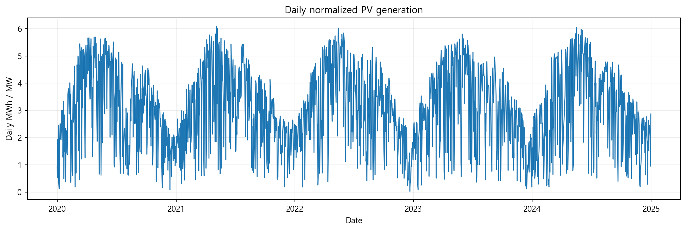
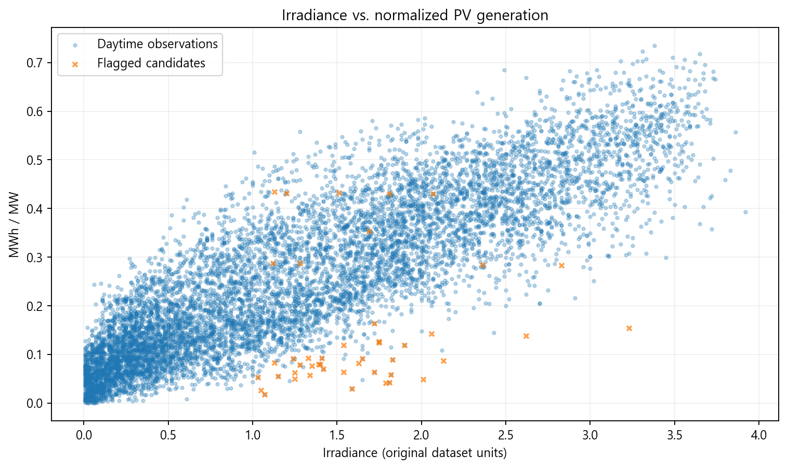
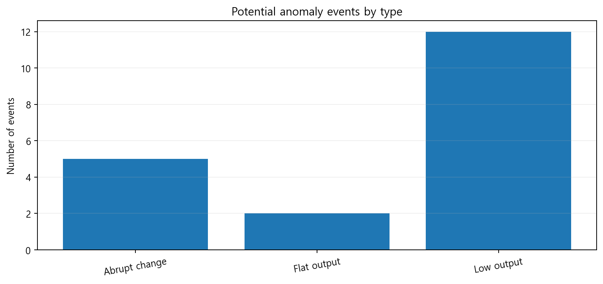
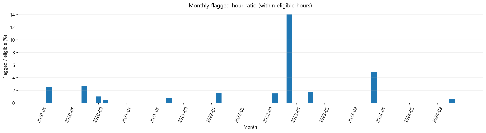
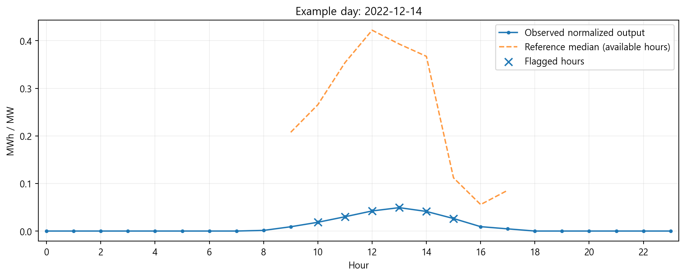

# 태양광 발전량 이상 패턴 자동 분석 보고서

- 데이터 파일: `C:\Users\leebi\Downloads\Portfolio-main\Portfolio-main\2026-2\pv_power_anomaly_detection\한국동서발전_지역별\PV_Dataset_충북.csv`
- 가상 예제 여부: **아니오**
- 유효 분석 행: **43,416행**
- 일사량 기준 탐지 대상: **11,411행**
- 이상 후보 이벤트: **19건**
- 이상 후보로 표시된 고유 시점: **45개**

## 이벤트 유형별 결과

| 유형 | 이벤트 건수 | 표시된 시간 합계 |
|---|---:|---:|
| 급격한 출력 변화 후보 | 5 | 5 |
| 출력 정체 후보 | 2 | 8 |
| 저출력 후보 | 12 | 33 |

## 결과 파일

- `pattern_data.csv`: 정규화발전량, 기준 패턴, 분석 가능 여부
- `reference_patterns.csv`: 기준 패턴별 표본수·중앙값·하위 사분위
- `anomaly_events.csv`: 연속 이상 후보 이벤트 단위
- `anomaly_samples.csv`: 탐지된 개별 시점
- `monthly_summary.csv`: 월별 탐지 후보 시간 및 비율
- `figures/`: 5개 분석 그림

## 분석상의 제한

- 탐지값은 추가 확인이 필요한 **후보**이며 실제 고장 진단 결과가 아닙니다.
- 참고 분포는 전체 관측기간으로 산출한 기술적 기준으로 미래 예측 모델/독립 테스트가 아닙니다.
- 상대적 저출력은 계절·시간대·일사량 이외의 기상/그늘/출력 제한 요인으로도 발생할 수 있습니다.
- 충북 집계 데이터로 개별 발전소의 고장 위치나 원인을 알 수 없습니다.
- 전처리 단계에서 제거된 원본 오류 및 날짜는 이 프로그램에서 복원되지 않습니다.
- 연속 검사는 정확한 1시간 간격의 데이터에서만 수행합니다.

## 그래프

